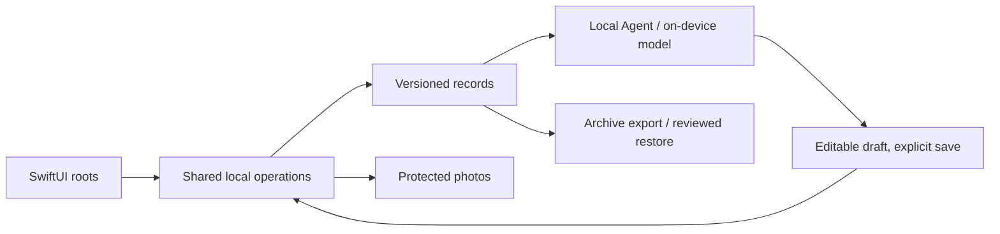

# Architecture

All V1 work runs on the device. No AQD API, auth, database, storage, queue, analytics, cloud AI or push service exists.

## Building blocks

| Concern | Choice | Rule |
| --- | --- | --- |
| UI | SwiftUI, native tabs, sheets, menus, forms | OS owns materials, keyboard and accessibility. Glass is guarded for iOS 26+ with an opaque fallback. |
| Records | SwiftData, CloudKit `.none` | Versioned migrations, stable IDs, revisions and operation receipts. Frozen delivered schemas. A corrupt or newer store is kept, never replaced with an empty one. |
| Media | App-private files, relative IDs, local thumbnails | Prepare media before committing references. Keep a metadata-minimized original and an edit recipe. Complete file protection and backup exclusion. Cleanup is reference-checked and retried. |
| Capture | PhotosPicker, native camera | Only user-selected images; permission requested at use. |
| Agent | Foundation Models when eligible | Bounded, confirmed context; typed fallback and reason-specific unavailability. |
| Weather | WeatherKit direct from the device | Needs the signed entitlement. Independent of model eligibility. |
| Recovery | Versioned archive via Files | Staged validation, reviewed full replacement. |

## Native standards

Layers, ownership, conventions and lint rules for `apps/ios` are defined in [apps/ios/AGENTS.md](../apps/ios/AGENTS.md) and enforced by `scripts/check-ios-layers.mjs`. Product-level rules:

- Check request and draft identity so stale async results never replace newer choices.
- A success receipt reports an acknowledged write, never an optimistic one. Test the real save and read path including failed and unknown-completion writes.
- Keep CloudKit off, file protection and backup exclusion intact; schemas are frozen once delivered and tested with populated old stores.
