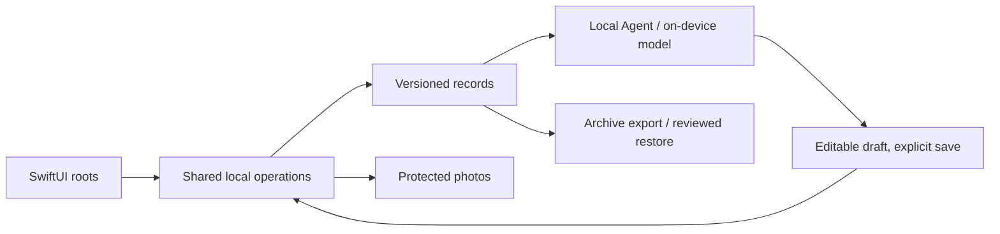

# Architecture

All V1 work runs on the device. No AQD API, auth, database, storage, queue, analytics, cloud AI or push service exists.

## Building blocks

| Concern | Choice | Rule |
| --- | --- | --- |
| UI | SwiftUI, native tabs, sheets, menus, forms | OS owns materials, keyboard and accessibility. Glass is guarded for iOS 26+ with an opaque fallback. |
| Records | SwiftData, CloudKit `.none` | Versioned migrations, stable IDs, revisions and operation receipts. Frozen delivered schemas. A corrupt or newer store is kept, never replaced with an empty one. |
| Media | App-private files, relative IDs, local thumbnails | Prepare media before committing references. Keep a metadata-minimized original and an edit recipe. Complete file protection and backup exclusion. Cleanup is reference-checked and retried. |
| Capture | PhotosPicker, native camera | Only user-selected images; permission requested at use. |
| Agent | Foundation Models when eligible | Bounded, confirmed context; typed fallback and reason-specific unavailability. |
| Weather | WeatherKit direct from the device | Needs the signed entitlement. Independent of model eligibility. |
| Recovery | Versioned archive via Files | Staged validation, reviewed full replacement. |

## Native standards

Paths are under `apps/ios`.

| Change | Owner |
| --- | --- |
| Pure rules, validation, value types | `Core/Sources/AQDCore` with Core tests |
| Records, receipts, migrations | `AQD/Persistence/PieceStore.swift` and native tests |
| Navigation and coordination | `AQD/AppState.swift`, `AQDApp.swift`, `UI/RootViews.swift` |
| Media | `AQD/Media/PhotoPreparer.swift` |
| Shared UI | `UI/AppTheme.swift`, `AppMetrics.swift`, `AppActions.swift`, `AppFields.swift`, `AppRows.swift`, `AppFeedback.swift`, `AppChip.swift`, `NativeTabs.swift` |

- Keep UI and SwiftData work on the main-actor boundary and media work in the isolated preparer. Check request and draft identity so stale results never replace newer choices.
- One owner per draft and navigation selection. Back, Cancel and interactive dismissal keep the source, selection and unsaved changes.
- A success receipt reports an acknowledged write, never an optimistic one. Test the real save and read path including failed and unknown-completion writes.
- Verify any new API against the installed SDK before use. Keep availability guards for the iOS 18 floor.
- Test pure rules in Core and persistence, media and recovery through native test seams, following the neighboring suite.
